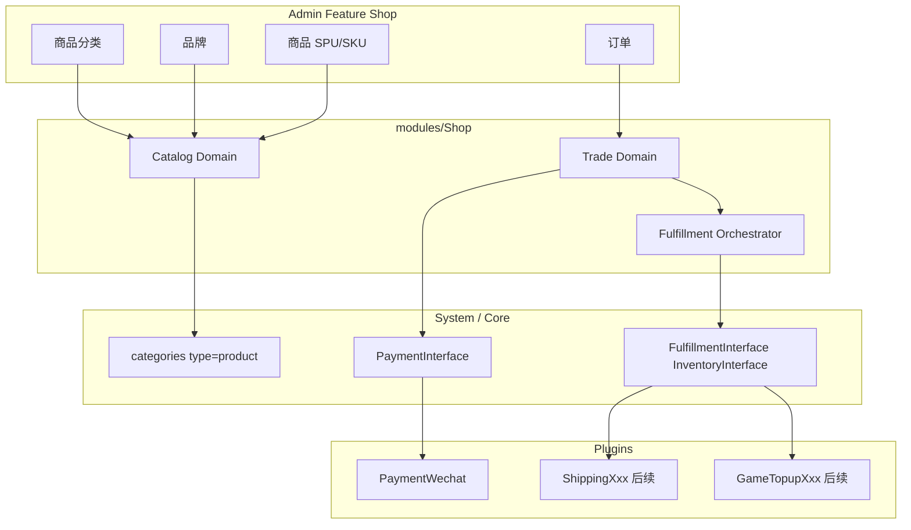
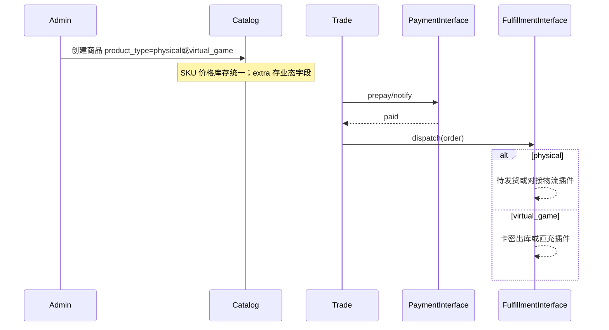

# Starship Shop 模块框架实现方案

> 参考 BeikeShop 的业务分层，在 Starship 的 Module / Plugin / Theme 边界内，将 `modules/Shop` 从「单品 + 单行订单 MVP」升级为可同时承载**普通商城**与**游戏商城**的交易中心骨架。  
> 原则：**一套内核、按 ProductType + Fulfillment 扩展，不拆两套系统。**

---

## 1. 背景与现状

当前 Shop（v0.1.0）已具备：

| 能力 | 说明 |
|------|------|
| 商品 | `shop_products` 单表（名称、价格分、库存、封面、上下架） |
| 订单 | `shop_orders` 单商品单行 + 支付字段 |
| 支付闭环 | `OrderService` → `PaymentInterface`（prepay / notify / query / refund） |
| 后台 | 商品管理、订单管理（菜单：「商城中心」） |

尚未具备：分类、品牌、SPU/SKU、购物车、订单行、履约抽象、游戏直充/卡密等。

相关路径：

- 模块：`modules/Shop/`
- 前端：`apps/admin/web-antd/src/features/shop/`
- 支付契约：`packages/core/src/Contracts/Payment/PaymentInterface.php`
- Cms 分类复用范例：`modules/Cms` + System `categories`（`type=article`）

---

## 2. 结论与默认取舍

1. **不照搬 BeikeShop 仓库结构**，只借其领域切分（商品中心 / 交易中心 / 履约 / 营销扩展）。
2. **普通商城与游戏商城共用一个 `modules/Shop`**，用 `product_type` + `FulfillmentInterface` 区分业态，不拆第二套订单 / 支付。
3. **第一阶段（P1）优先**：后台「商品中心」骨架 + 扩展点契约；现有支付闭环保持可跑，订单表结构升级放到 P2。
4. **分类**：照 Cms 模式复用 System `categories`，新增字典 `category_type=product`，独立权限 `shop.categories.*`。
5. **物流 / 直充渠道**：走 Plugin + Contract；Shop **禁止**直接依赖具体插件类（与现有支付约束一致）。

### 普通商城 vs 游戏商城（为何不拆架构）

| 维度 | 普通商城 | 游戏商城 |
|------|----------|----------|
| 履约 | 物流发货、退货 | 卡密 / 直充 / 区服账号 |
| SKU | 规格属性 | 面额、区服、渠道等 |
| 库存 | 实物库存 | 卡密池或渠道余额 |
| 风控 / 合规 | 物流与售后 | 盗刷、实名、未成年等 |

**共性更大**：商品、下单、支付、订单状态、退款、会员骨架可共用。分开的应是**业态扩展与前台体验**，不是两套交易底座。

仅当团队、合规、订单模型长期完全分叉时，再考虑独立 Module / 仓库。

---

## 3. 与 BeikeShop 的映射（取其神，不取其形）

| BeikeShop 能力块 | Starship 落点 | 阶段 |
|------------------|---------------|------|
| Catalog（分类 / 品牌 / 商品 / 规格） | `modules/Shop` + System `categories` | P1 |
| Product 多类型 | `product_type` + `extra` / 类型扩展 | P1 预留，先落地 `physical` |
| Cart / Checkout | Shop Domain + 前台 Theme / API | P3 |
| Order / Payment | 已有 Shop 订单 + Payment Contract | P1 维持，P2 升级订单模型 |
| Shipping / 发货 | Fulfillment Contract + 物流插件 | P2 |
| 游戏直充 / 卡密 | 同一 Fulfillment 的 `virtual_game` 实现 | P2 末或 P3 |
| Marketing | Shop 内子域或后续能力，**不**先做成 Plugin type | 延后 |
| Admin UI | `apps/admin/web-antd/src/features/shop` | P1 |
| Storefront | Theme 依赖 Shop Module | P3 |

说明：仓库内 BeikeShop 相关提及主要用于**插件配置 Schema 命名兼容**，并非商城架构蓝本；本方案是领域参考，不是代码搬运。

---

## 4. 目标架构



### 内核原则

- Shop 拥有商品 / 订单真相；支付、物流、直充只通过 Contract。
- 商品必须有 `product_type`（首批：`physical` | `virtual_game`；建议字典可维护）。
- 履约不写死在 `OrderService`：支付成功后调用 `FulfillmentInterface::dispatch(order)`（或领域事件），按类型路由策略。

---

## 5. 目录与包内分层（建议）

在 `modules/Shop` 内按 Domain 收敛（不必一次拆微服务）：

```text
modules/Shop/
  app/
    Domain/Catalog/     # Product, Sku, Brand, Attribute, ProductType
    Domain/Trade/       # Order, OrderItem, Cart(后续)
    Domain/Fulfillment/ # 编排，不放具体渠道 SDK
    Http/Controllers/Admin|Api/
    Support/            # ShopPermissions, ShopCategoryType, ShopProductType
    Providers/
  database/migrations/
  database/seeders/
  routes/admin.php
  routes/api.php
```

### 后台菜单建议

- 商城中心
  - 商品分类（复用 `categories`，`type=product`）
  - 品牌管理（P1 可与商品同批或紧随）
  - 商品管理（SPU + SKU）
  - 订单管理（P1 仍用现表；P2 换订单行）

---

## 6. 数据模型演进

### P1 — 商品中心

在现有 `shop_products` 上演进，避免大爆炸。

#### 6.1 扩展 `shop_products`（SPU）

建议新增字段：

| 字段 | 说明 |
|------|------|
| `category_id` | 系统分类 ID（`categories.type=product`） |
| `brand_id` | 可空，关联 `shop_brands` |
| `product_type` | `physical` / `virtual_game` 等 |
| `subtitle` | 副标题 |
| `images` | JSON 图集 |
| `sort` | 排序 |
| `extra` | JSON，业态扩展（游戏区服提示等） |

价格、库存逐步下沉到 SKU；SPU 层可保留展示用冗余或废弃直改库存。

#### 6.2 新建 `shop_product_skus`

| 字段 | 说明 |
|------|------|
| `product_id` | SPU |
| `sku_code` | 编码 |
| `specs` | JSON 规格 |
| `price` | 价格（分） |
| `stock` | 库存 |
| `status` | 状态 |
| `extra` | 可选，SKU 级扩展 |

无规格商品落 **一条默认 SKU**，保证后续下单只认 SKU。

存量商品迁移：为每条旧商品生成默认 SKU，并回填订单侧兼容字段。

#### 6.3 新建 `shop_brands`（可同批）

`name`, `logo`, `sort`, `status`。

#### 6.4 分类

- 字典 `category_type` 增加 `product`（标签：商品）。
- 新增 `Modules\Shop\App\Support\ShopCategoryType::PRODUCT = 'product'`。
- 后台 CRUD 模式复制 Cms 栏目：共用 `categories` 表，独立 `shop.categories.*` 权限与 `/shop/categories` 菜单。

#### 6.5 订单（P1）

**不强制重构订单表。** 建议增加可空 `sku_id`，创建订单时写入默认 SKU，便于向前兼容。

---

### P2 — 交易 / 履约

- 保留 `shop_orders` 头表，新增 `shop_order_items`（SKU 快照、数量、单价、行履约状态）。
- 履约快照：`fulfillment_type`、`fulfillment_payload`（JSON：收货地址 **或** 游戏账号 / 区服）。
- 库存：改走 SKU + 可选库存流水；抽象 `InventoryInterface`（默认由 Shop 本模块实现）。
- Core 新增契约（建议路径）：
  - `packages/core/src/Contracts/Shop/FulfillmentInterface.php`
  - `packages/core/src/Contracts/Shop/InventoryInterface.php`
- System / Shop 提供默认占位实现；物流 / 直充插件启用后覆盖绑定。

---

### P3 — 购物车与前台

- `shop_carts` / `shop_cart_items`
- 前台下单 API + Theme 依赖 Shop
- 营销（券等）另开子域，不挤进 P1

---

## 7. 普通 vs 游戏：同一框架内的表达



### P1 必须先写清的约定（即使游戏履约未实现）

1. `ShopProductType` 常量 + 字典项。
2. 后台商品表单按 `product_type` 切换扩展字段区（游戏字段可先只写 `extra`，不做直充）。
3. `FulfillmentInterface` + `NullFulfillment` / `PhysicalPendingFulfillment` 占位，避免日后推倒 `OrderService`。

---

## 8. 权限与菜单（P1）

扩展 `ShopPermissions` 与 `ShopMenuSeeder`：

| 权限前缀 | 说明 |
|----------|------|
| `shop.categories.*` | 查询 / 新增 / 下级 / 编辑 / 删除 / 批量 / 状态 / 排序 |
| `shop.brands.*` | 若做品牌 |
| `shop.products.*` | 保留并按需扩展 SKU 相关按钮 |
| `shop.orders.*` | 维持现有 |

前端：

- `features/shop/views/categories/`：可复用 Cms 栏目页模式。
- 商品表单改为 SPU + SKU。
- 菜单 `component` 继续使用 `/shop/...` 约定；`router/access.ts` 已支持 feature 带模块前缀映射。

---

## 9. 分阶段交付清单

### 阶段 P1 — 商品中心框架（建议下一迭代）

1. 字典增加 `product`；`ShopCategoryType`；Cms 式栏目 API / 菜单 / 前端。
2. 迁移：扩展 `shop_products`；新建 `shop_product_skus`；可选 `shop_brands`；旧数据默认 SKU；订单可空 `sku_id`。
3. Admin 商品：按类型筛选；SPU + SKU 编辑；创建自动默认 SKU；`product_type` 扩展区。
4. Core：`FulfillmentInterface` + Shop 占位实现；`OrderService` 支付成功后预留调用点。
5. 文档：更新 `docs/architecture/development-checklist.md` 与 Module 规范中的「Shop 业态扩展约定」。
6. 测试：分类 scoped CRUD；商品 + 默认 SKU；`ShopOrderPaymentTest` 仍绿。

### 阶段 P2 — 订单与履约

1. 订单头 + 订单行；地址 / 充值账号快照。
2. 库存改走 SKU + Inventory 抽象。
3. `physical` 履约状态机（待发货 / 已发货）；预留物流插件绑定点。
4. `virtual_game` 履约策略骨架（卡密表或直充插件接口）。

### 阶段 P3 — 购物车与前台切片

1. Cart API；会员与订单绑定（checklist 中延后项）。
2. Theme 商品详情 / 下单页依赖 Shop。
3. 营销子域按需启动。

---

## 10. 明确不做（避免做成第二个 BeikeShop 单体）

- 不把完整 Beike 后台、多商户、全套营销一次性搬进 Shop。
- 不新建独立商品分类表（禁止再造 `shop_categories` 与 System 双轨）。
- 不在 Shop 内写死微信或某直充 SDK。
- 不在 P1 重做前台主题与购物车。

---

## 11. 风险与兼容

| 风险 | 应对 |
|------|------|
| 存量商品 / 订单 | 迁移生成默认 SKU；测试订单走默认 SKU |
| 金额单位 | 继续「分」整数，与现表一致 |
| 菜单 component | 继续 `/shop/...` + feature views，避免 pageMap 404 |
| 支付回归 | P1 结束后 `ShopOrderPaymentTest` 必须通过 |

---

## 12. 与仓库其他文档的关系

| 文档 | 关系 |
|------|------|
| `docs/architecture/development-checklist.md` | 勾选 Shop 后续阶段；P1 完成后更新 |
| `docs/architecture/Starship_Module_Plugin_Theme_实现方案.md` | Shop 属 Module；支付 / 物流属 Plugin |
| `docs/deployment/Starship_Module_开发规范.md` | Shop 禁止依赖具体支付插件类 |
| `docs/deployment/Starship_Plugin_开发规范.md` | shipping / 直充等需 Shop + Contract 后再评估 Plugin type |
| `docs/deployment/Starship_Theme_开发规范.md` | P3 前台主题依赖 Shop Module |

---

## 13. 修订记录

| 日期 | 说明 |
|------|------|
| 2026-07-16 | 初稿：BeikeShop 参考 + 普通/游戏共用架构 + P1/P2/P3 分期 |
